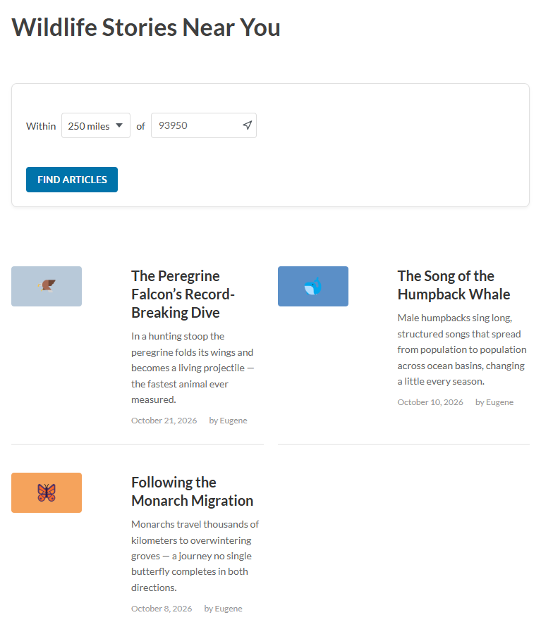

# Working with HyperTaxonomy
{: .no_toc }

When [HyperTaxonomy](https://hypertaxonomy.org/hypertaxonomy/) is active alongside As the Crow Flies, additional features become available. None require configuration beyond enabling the relevant taxonomies in As the Crow Flies' settings.

## Table of contents
{: .no_toc .text-delta }

1. TOC
{:toc}

---

## Term group expansion

HyperTaxonomy's [term groups](https://hypertaxonomy.org/hypertaxonomy/user-guide/term-groups.html) let you collect taxonomy terms into named sets (e.g. "Downtown Branches", "Partner Stores"). As the Crow Flies can expand a group into its member terms automatically, so you don't have to maintain a static list of term IDs in every shortcode and block.

### In shortcodes

Add `group="<group_id>"` (or a comma-separated list) to `[atcf_locations]` or `[atcf_nearby]`. The group's members are resolved at render time and merged with any `term` IDs already specified:

```
[atcf_locations group="7" radius="10"]
[atcf_nearby group="7,12" nearby_taxonomy="stores" radius="20"]
```

The `taxonomy` attribute is used to determine which of each group's members to include. When `taxonomy` is omitted, members in every taxonomy enabled in As the Crow Flies are included.

### In blocks

The **Location Finder** and **Nearest Location** block inspector panels show a **Term Groups** checklist when HyperTaxonomy is active. Check one or more groups; their members are expanded server-side at render time and merged with any specific terms selected above the checklist.

Group members and directly-selected terms are deduplicated automatically.

The underlying expansion is also available programmatically via `atcf_expand_htax_groups()` — see the [PHP API](../developer-reference/php-api.html).

---

## Settings

The **Term Groups** taxonomy (slug: `group`) is automatically excluded from the **Enabled Taxonomies** list in **Settings&nbsp;→ As the Crow Flies&nbsp;→ General** when HyperTaxonomy is active, since attaching locations to group terms directly is not meaningful.

---

## PowerSearch and Search Widget

The [`near:` operator](https://hypertaxonomy.org/hypertaxonomy/user-guide/powersearch.html#query-syntax) in HyperTaxonomy's PowerSearch, and the Search Widget's [distance filter](https://hypertaxonomy.org/hypertaxonomy/user-guide/search-widget.html#ht_distance_field--location-based-distance-filter), both use As the Crow Flies' distance engine. They find every matching location within the radius. No additional configuration is required — enabling a taxonomy in As the Crow Flies' settings is sufficient.

[{: .screenshot-small}](../assets/images/screenshots/distance-field.png)

---

## Matching locations across sites

With [TermConnect](https://hypertaxonomy.org/termconnect/) active as well as HyperTaxonomy, terms on different sites can match by shared location, even when their slugs and names differ. HyperTaxonomy adds each term's normalized address to the identifiers TermConnect compares across sites.

---

## Term merges and conversions

Locations belong to a term, and HyperTaxonomy [merges and conversions](https://hypertaxonomy.org/hypertaxonomy/user-guide/merge-convert.html) replace terms: a merge deletes the merged terms, and a conversion creates a new term and deletes the old one or keeps it as a redirect stub. When the terms have locations, the Merge Terms and Convert Terms pages ask where they go:

| Choice | What happens | Default |
|---|---|---|
| **Leave them on the redirect stubs** | Each stub keeps the locations of the term it replaces. Needs stubs | With stubs |
| **Move them to the target** or **to the new terms** | Locations the target already has (per your **Location Matching** settings) aren't added again | Without stubs |
| **Copy them, and leave them on the redirect stubs** | Both have them. Needs stubs | |
| **Delete them** | No term keeps them | |

When the new taxonomy isn't enabled in As the Crow Flies settings, a conversion can't move locations to the new terms: they stay on the stubs, or are deleted without stubs. The page reports how many locations were added and kept. Merges and conversions started outside these pages, such as by the Categories to Tags Converter, use the defaults, unless whatever started them asked for something else. A term converted back to its stub gives its locations back to the stub.
